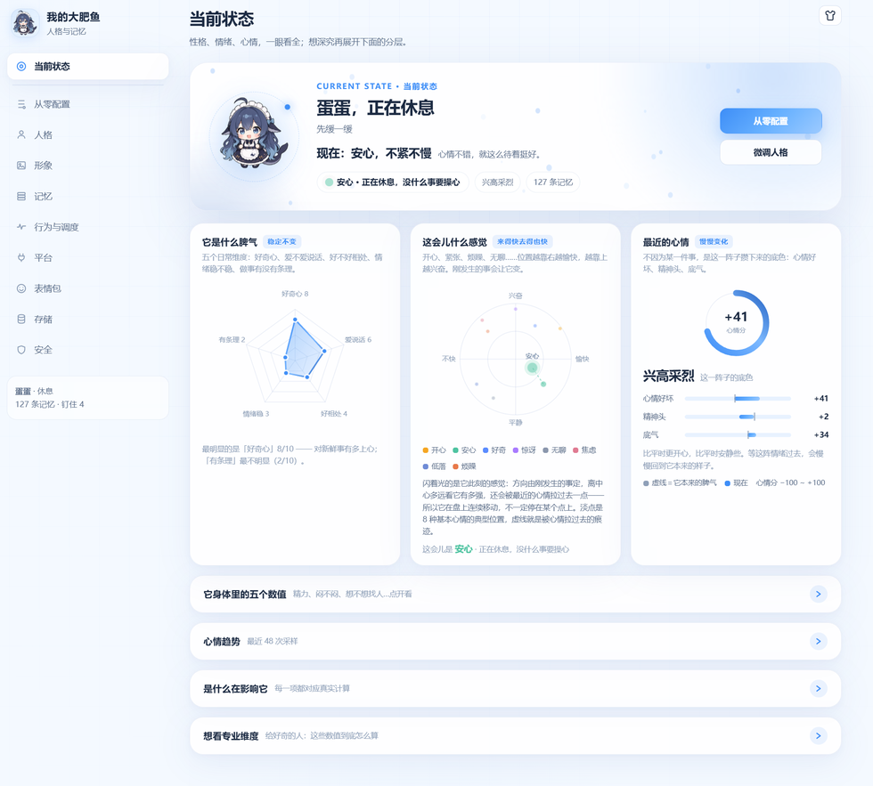

# 大肥鱼 · 一条会记事、有脾气、会自己过日子的 DSH 插件

> 不是让模型「扮演」一个角色，而是让同一条鱼一直活着。

大肥鱼是给 **DeepSeek Harness（DSH）** 用的人格成长插件。装进 DSH 之后，你在里面开的每一个会话都是同一个她——写代码、查资料、做表格、闲聊，都是。她不是独立应用，也不接管你的模型，只是往系统提示词里注入「她是谁」「她记得什么」「她现在什么心情」。

**English:** A DeepSeek Harness (DSH) plugin that keeps one persistent persona across every session, with layered memory, mood and state, and optional Douyin automation.

如果你正在找的是「让 DSH 的每个会话都保持同一个人格」「给 DSH 加一套能长期用的记忆」「让角色有自己的状态，而不是每次重新扮演」，它就是做这件事的。它不是独立聊天应用，也不替代 DSH 的模型和工具。



*这是她的「当前状态」页：现在什么心情、性格五维、最近记住了什么，一眼就能看到。*

## 一眼看懂

| 她有什么 | 说人话 |
|----------|--------|
| **人格锚定** | 模型在运行中改不了她的身份；会烦、会顶嘴、会不想干，不会聊着聊着变成客服 |
| **三层记忆** | 钉住的事、慢慢养出来的习惯、最近经历过的事，换个会话也接得住 |
| **自己的状态** | 心情、精力、无聊与否会跟着聊天和时间变；有作息，也有每天的行动预算 |
| **自己的生活** | 会自己安排什么时候醒着、什么时候安静，不用你下指令才动 |
| **抖音日子**（可选，默认关） | 用本机浏览器登录后，自己刷、自己互动、回私信、偶尔 @ 你 |
| **表情包库** | 上传、链接导入、整包装入，按情绪和语义检索，抖音 / B站 / QQ 共用一套 |
| **形象库** | 13 张内置三视图，缩略图随仓库；原图整套从 Release 下载。也能从本机上传自己的形象，只在这台电脑可用 |
| **会画图**（Windows，入口默认隐藏） | 调用本机豆包桌面版作图，不需要 API Key |

## 她到底是什么

她由四层东西撑起来：

- **人格**：她是谁、怎么说话、在意什么、哪些事不做；
- **记忆**：你告诉过她的事，她会在之后想起来；
- **状态**：心情、精力、无聊、社交需求、创作欲，会随着聊天和时间变化；
- **行动**：她可以自己安排什么时候醒着、什么时候安静，也可以去抖音过日子（可选）。

代码只是骨架，真正让她像活的是这四层之间的咬合：人格决定她怎么理解一句话，记忆决定她接不接得住，状态决定她今天想不想说话，行动决定她会不会自己游过来。

## 为什么你会想留下她

### 她有自己的性格，不会聊着聊着变成客服

她有人格锚点，模型在运行中改不了她的身份。她会烦、会不想干、会顶嘴，也会在陌生人面前收着；说话有自己的习惯，不会每段都「首先、其次、最后」，也不会动不动来一句「希望这能帮到你」。

设置页可以改她的性格、说话方式、喜好和边界，改完下一轮就生效。

### 她真的记得你

她的记忆分三层：

- **钉住的事**：你的名字、她怎么称呼你、你们之间不能忘的事；
- **她的习惯**：慢慢养出来的偏好和相处方式，会随时间变淡；
- **那天的事**：最近聊过什么、一起经历过什么，也会随时间变淡。

对话不整段入库：自动收录每天有配额，每轮注入也挑最相关的几条。所以你在另一个会话里随口提过的事，她在这个会话里也可能接得住；她不会把聊天记录整段倒出来。记忆只会变淡、归档，不会真删。

### 她有自己的生活，不是等你下指令才动

她有自己的状态和作息：什么时候有精神、什么时候想睡、什么时候想找人说话。默认夜里 23:00–07:00 不打扰你，每天最多自己醒来 8 次；她可以自己安排一次活动，也可以什么都不做。

她不是「定时发一句话」的机器人，而是会判断「现在想不想、适不适合」的那种。

### 她可以去抖音过日子（可选，默认关）

打开平台权限后，她可以用本机浏览器扫码登录抖音，自己刷、自己看评论，偶尔点个赞、收个藏、留一句评论，也可以在你允许的时候 @ 你。值班时她能读到标题和评论区；开了画面理解才能截两帧看画面，开了喜欢列表才会去看你主页新喜欢的封面。看到什么值得记的，她自己写进记忆，再按自己的判断动手。

私信这边，只有**主人**和你在「记忆名单」里放进来的人，才能让她调用长期记忆；名单外的人只读当前这段对话，不碰她的记忆库。

这些都要你自己打开，默认全是关的。平台自动化不是官方接口，账号风险需要你自己承担，建议先用小号、低频试用。

### 你可以把她养成自己的样子

- 设置页「从零配置」：起名、她怎么称呼你、性格原型、说话方式、喜好与来历，五步完成；
- 「用 AI 一键生成」：把提示词模板复制给任意 AI，把返回的人格卡粘回来，自动填好；
- 「说句话，帮你调」：用大白话描述想改哪里，她先出预览，你确认才写入；
- 也可以直接改人格文件、记忆写法、平台配置，改成你想要的鱼。

### 她还会收表情包

表情包可以上传、从链接导入，也可以整包装进来；找图时按情绪和语义检索，不用自己记文件名。同一套表情包库以后接别的平台也不用重新养。

表情包页有一个「标语义」按钮。只有你点它，她才会让当前 DSH 模型逐张看图和文字，补上「这张图是什么意思、适合什么场合」；这会消耗你 DSH 模型的调用额度，所以下载或入库时不会自动标，失败也不会定时重试。标的时候有进度条，可以中途停止，页面不会被卡住。标过语义的图优先级最高；没标的老图只能按标签当低优先级兜底，不会拿去顶内容型回复。语义标注和图片本体一起留在本机，不随仓库分发。

### 她也认你给的形象

「形象」页里有一套内置的三视图：13 张 2848×1600 原图加起来约 74MB，所以仓库只带 640×360 的缩略图，原图放在 GitHub Release。第一次进页面时缩略图直接可见；点「原图资源」里的下载，她才把整套原图拉到本机。下载中可以继续用页面，失败不会留下半套图；下载完成后可以重新下载，也可以只删除本机原图，缩略图仍然保留。

你也可以上传自己的形象：在「本机形象」卡片点「上传形象」，选电脑里任意位置的 PNG / JPEG / WebP / GIF / BMP / AVIF 图片。不再按 12MB 拦截，服务端只保留 64MB 的内存安全线；图片和缩略图会复制到 `data/characters/uploads/`，只在这台电脑上显示，不进 Git，也不随插件分发。上传时造型分类默认是「本机上传」，可以点开选已有分类，也可以清空后自己起一个名字；不需要勾「这张图是我自己的」，直接保存到本机就行。

缩略图点一下会先选中，上方大图再点一下才会浮起来；大图里可以用鼠标滚轮放大，放大后按住拖动看细节。

## 聊天里怎么使唤她

除了在界面里点按钮，聊天中也能直接调用这几个工具：

| 工具 | 作用 | 什么时候会用到 |
|------|------|----------------|
| `fish_memory_search` | 只读查长期记忆：最近经历、平台动态、相关记忆 | 你问「记不记得…」「上次那个…」 |
| `douyin_run` | 起一轮抖音值班，她自己看、自己决定动不动手 | 你说「刷抖音」「去看看抖音」 |
| `douyin_state` | 看这一轮刷到哪了、上次结果如何 | 你说「刷到哪了」 |
| `doubao_paint` | 用本机豆包桌面版画一张图（仅 Windows，许可需打开） | 你说「画一张」「给我画个…」 |
| `doubao_paint_status` | 看豆包做图能不能用、是不是正在画 | 画不出来时先查这个 |

工具按依赖注册：记忆库没起来就只有抖音相关的，没装豆包 / 不在 Windows 就没有画图工具。缺了不会拖垮插件。

## 三分钟把她装进 DSH

前提：已经装好 **DSH Desktop**，Node.js **>= 22.19**（推荐 24）。这是 DSH 插件，不是独立应用。

### 作为 bundle 装进 profile

在 DSH profile 的 `package.json` 里加依赖，并把插件挂进 bundles：

```json
{
  "dependencies": {
    "dsh-fish-dandan": "link:/absolute/path/to/dsh-fish-dandan"
  },
  "dsh": {
    "profile": {
      "bundles": [
        "@deepseek-ai/dsh-base",
        "@deepseek-ai/dsh-web-app",
        "dsh-fish-dandan"
      ]
    }
  }
}
```

把 `/absolute/path/to/dsh-fish-dandan` 换成你本机的真实路径，然后重启 DSH。

### 打开设置页

插件加载后，在 DSH 里找到：

**设置 → 我的大肥鱼 → 打开设置页**

第一次打开她，按钮写的是「花一分钟认识它」：她会先问你怎么称呼，而不是来一段自我介绍。之后这里会变成「打开设置页」，也能在浏览器里直接访问 `http://127.0.0.1:<DSH 端口>/fish-dandan/ui`（默认只允许本机回环访问）。

### 本地开发挂载

不想走 bundle，也可以直接挂源码：在 profile 的 `cordis.patch.yml` 末尾 `insert` 本仓库的 `src/index.js`，重启后看 `data/plugin.log`。详细步骤和排错表见 [`docs/开发说明.md`](./docs/开发说明.md)。

## 数据都在哪

养鱼真正有用的是人格、提示词和配置，所以**当前人格与公开设置会跟着仓库走**，让别人拿到就能在你的基础上改；聊天记录、记忆库、收件箱、登录态和表情包大文件仍然只留在本机：

```
data/
├── persona/core-persona.json   # 当前人格（入库，可公开）
├── persona/audit.jsonl         # 人格改动审计（只在本机）
├── memory/memory.db            # 记忆库（只在本机）
├── state/platform-settings.json # 平台开关与表达浓度（入库）
├── state/decision.json         # 心情 / 精力 / 作息（只在本机）
├── state/douyin-journal.json   # 她做过什么的流水账（只在本机）
├── state/douyin-inbox.json     # 私信收件箱（只在本机）
├── stickers/                   # 表情包本体与语义标注（只在本机，体积大）
├── images/                     # 豆包画的图（只在本机）
├── characters/                 # 本机上传形象 + 原图资源包（只在本机）
├── templates/                  # 卡片底图 / 头像等本地素材（不随仓库分发）
└── plugin.log                  # 运行日志（只在本机）
```

想备份或换机器，复制 `data/persona/`、`data/memory/`、`data/state/platform-settings.json` 和 `data/characters/` 就够了。表情包本体和语义标注在 `data/stickers/`，想一起搬也可以复制；抖音登录态在 `data/browser-profile/`，那是账号凭证，**只留在自己机器上**。

设置页的「存储」会把这些本机数据按类别列出来。它只清两类东西：可以重新生成的页面/脚本/显卡缓存，以及旧版单独监听留下的档案；登录态、人格、记忆、形象原图和表情包都不会被删。清理前会出二次确认，不会一键静默清空。

## 仓库里带了一套「养成配方」

只给代码，别人拿到的是一个空框架；养出来的鱼还是会有很重的「AI 味」。所以这个仓库把能公开的养成配方也放进去了：

| 文件 | 里面是什么 |
|------|------------|
| [`data/persona/core-persona.json`](./data/persona/core-persona.json) | **当前实际人格**：不是空模板，别人拿到仓库就能直接继承她的身份、五维、说话方式与边界 |
| [`data/state/platform-settings.json`](./data/state/platform-settings.json) | **当前实际平台设置**：作者公开身份与现有开关；不满意可在设置页改 |
| [`persona/default-persona.json`](./persona/default-persona.json) | 重置人格时用的默认结构 |
| [`data/share/persona.example.json`](./data/share/persona.example.json) | 一份完整的人格示例：身份、五维、说话方式、喜好、边界、来历 |
| [`data/share/platform-settings.example.json`](./data/share/platform-settings.example.json) | 一份安全的平台设置起点：自动刷和监听默认关闭；预填了能直接体验「艾特主人」和「私信认人」的默认值 |
| [`data/share/memory-samples.jsonl`](./data/share/memory-samples.jsonl) | 8 条示例记忆，演示「钉住的事 / 习惯 / 那天的事」怎么写 |
| [`persona/presets/voice-default.json`](./persona/presets/voice-default.json) | 出厂语气与脾气预设：短句、分条、会烦、会拒绝，这才是「像人」的那部分 |
| [`data/share/README.md`](./data/share/README.md) | 怎么复制、哪些不能提交、分享前怎么自检 |

不随仓库走的是**运行痕迹**，不是「像人」的配置：`data/memory/`、`data/persona/audit.jsonl`、`data/state/decision.json`、`data/state/douyin-*.json`、`data/browser-profile/`、`data/plugin.log`。这些要么是私密记忆，要么是本机登录态和运行日志，别人拿到也没有意义。

想直接拿来用，可以先把示例复制到运行目录（平台设置通常不用手动复制，首次打开会自动读取示例；想从示例重新开始时再复制）：

```bash
cp data/share/persona.example.json data/persona/core-persona.json
cp data/share/platform-settings.example.json data/state/platform-settings.json
```

Windows PowerShell 用 `Copy-Item` 即可。

## 抖音模式：先把边界说清楚

抖音功能是整条鱼里最「外面」的一部分，所以默认全部关闭，打开前请先知道：

- 它走的是本机浏览器自动化，不是抖音官方接口，**有账号风险**；
- 点赞、收藏、评论、回复、私信都是单项开关，关掉之后她就做不了；
- 它自己的决策循环里，对外动作默认不自动执行；但抖音值班和私信监听是另一条路——互动由它当场判断后直接做，不会逐条问你，所以频控和开关才是硬边界；
- 评论和私信不是一律发表情包：先判断这句话是内容型还是短社交；内容型只发文字，短社交才按「自己的表情包 → 抖音面板表情 → 文字」的顺序选，匹配不稳就退回，不硬发；
- 她不会代表你向陌生人承诺什么，也不会把密钥、本机路径写进对外文本；
- 建议先用小号、低频率，确认行为符合你的预期再慢慢放开。

## 常见问题

### 这是独立应用吗？需要自己准备模型 API Key 吗？

不是独立应用，是 DSH 插件。它不接管模型，只在 DSH 的会话里注入人格、记忆和状态；模型仍然用你 DSH 里已经配好的那套。豆包作图走本机豆包桌面版，也不需要额外 API Key。

### 装好之后，所有会话都会变成同一个人格吗？

同一个 DSH profile 里，所有会话共用一套人格。人格设定按轮次注入，在会话里改完，下一个回合就按新的来；换会话不会换人。

### 它和别的 persona / memory 插件能一起装吗？

不建议同时开多个都往系统提示词里注入人格、都抢记忆读写权的插件。它们会互相覆盖或争上下文；想换插件时先停掉旧的。只做别的事、不碰人格注入和记忆的插件一般可以共存。

### 记忆存在哪里？会上传到网上吗？

记忆库、收件箱、登录态、流水账和运行日志都只在本机的 `data/` 下，仓库里不带这些运行数据。模型请求本身会经过你配置的 DSH 模型服务，这一点和普通 DSH 会话一样；插件不会另外把记忆传到别的服务。

### 表情包为什么要「标语义」？

表情包光有图片不够，AI 得先知道这张图是什么意思，才敢在合适的对话里发。标语义就是让当前 DSH 模型看图并写一句图义、情绪、适用意图和置信度。它只在你点按钮时跑，不会下载完就自动标；标完的语义和图片本体一起留在本机，不随仓库分发。没标语义的旧图只能当很低优先级的兜底，评论和回复不会拿它硬顶。

### 上传的形象会进 Git 吗？

不会。上传时图片和缩略图复制到 `data/characters/uploads/`，这个目录和 `data/stickers/` 一样被 `.gitignore` 挡住，只在本机显示，不随插件分发。换电脑需要把 `data/characters/` 一起复制过去，或者重新上传。

### 为什么内置原图不直接放在仓库里？

13 张 2848×1600 PNG 合计约 74MB，直接进 Git 会让第一次 clone 很重。仓库只保留 640×360 的 WebP 缩略图，原图放 GitHub Release，需要时在「原图资源」里整套下载到本机；下载失败不会留下半套图。

### 抖音功能必须开吗？

不必须，默认全关。打开后走本机浏览器自动化，不是抖音官方接口，有账号风险；建议先用小号、低频试用。只想聊天、写代码、做表格，可以完全不碰它。

### 为什么她不主动说话 / 不刷抖音？

先看三个地方：平台权限是不是关着、当前是不是在 23:00–07:00 的安静时段、今天是不是已经用完了主动醒来的次数。默认设置就是「少打扰」，不是坏了。

### 支持哪些系统？

当前主要在 Windows 上开发和验证。插件本体的运行环境取决于 DSH；豆包作图只支持 Windows，抖音自动化也需要本机浏览器。其他系统没有完整验证，遇到问题先看 [`docs/开发说明.md`](./docs/开发说明.md)。

### 能商用、改名或再发布吗？

代码是 MIT，可以 fork、改名、商用和再发布，保留版权与许可声明即可。`assets/icon.png`、`assets/avatar.png` 是 CC BY-NC-SA 4.0 的同人素材，不能直接商用；商用前换成自己的图。详见下面的「开源协议」。

## 感谢与借鉴

这套东西不是从零发明的。下面这些项目和社区讨论，给了我很直接的帮助。我尽量只借机制、参数和设计判断，不复制别人的源码；遇到不能兼容的许可证，就只做思路参考。

| 项目 | 我们借了什么 | 许可证 | 怎么处理 |
|------|--------------|--------|----------|
| [dsh-agent-md](https://github.com/wwsmiler1-bit/dsh-agent-md) | 人格按回合注入、改完下一回合生效、注入记录 | MIT | 借注入思路，不复制实现 |
| [dsh-fish-memory](https://github.com/Yuuyuko-uu/dsh-fish-memory) | 每天 8 条配额、命中才注入、半衰期 | NOASSERTION（自定义非 OSI 许可） | 只借参数和机制，不复制代码 |
| [dsh-soul-md](https://github.com/Scorp1o117/dsh-soul-md) | 人格卡分层、动态召回预留 | MIT | 借分层思路 |
| [astrbot_plugin_memory_companion](https://github.com/menglimi/astrbot_plugin_memory_companion) | 人物卡、亲密度六档、断言层 | MIT | 借机制和结构 |
| [dsh-bili-whale](https://github.com/Alterssss/dsh-bili-whale) | 生物钟、随机开摆、两本日记、@ 主人的边界 | MIT | 借行为剧本和边界 |
| [dsh-bili-scroll](https://github.com/c1overzz/dsh-bili-scroll) | 最小权限白名单、可审计配额、谷时运行 | MIT | 借权限和配额模型 |
| [dsh-douyin-scroll](https://github.com/NEWJO123/dsh-douyin-scroll) | 草稿/确认、三重闸 | MIT | 借审批语义 |
| [dsh-whale-musume](https://github.com/Sutera-Diffusus/dsh-whale-musume) | 工作态不插嘴、低频关怀 | MIT | 借节奏和克制 |
| [dsh-pet-indesktop](https://github.com/MerZlin/dsh-pet-indesktop) | 默认全关、只写元数据、零外网 | MIT | 借隐私原则 |
| [dsh-nekowhale-stickers](https://github.com/Loping151/dsh-nekowhale-stickers) | 按情绪检索表情包 | 代码 Apache-2.0 / 素材 CC BY-NC 4.0 | 只借检索机制，不复制素材 |
| [blue-fish-archive](https://github.com/EDMOK/blue-fish-archive) | 同人表情包来源参考 | 无 License 文件（README 标 CC BY-NC-SA 4.0） | 未复制任何素材 |
| [astrbot_plugin_self_learning](https://github.com/NickCharlie/astrbot_plugin_self_learning) | 每人/总量上限的结构 | AGPL-3.0 | 只借结构，不复制代码 |
| [astrbot_plugin_private_companion](https://github.com/menglimi/astrbot_plugin_private_companion) | 主动候选闸门、入站防抖 | 无 License | 只借机制，不复制代码 |
| [billion-context](https://github.com/ranxianglei/billion-context) | 可逆增量、前缀缓存友好的可观测思路 | MIT + 附加署名 | 只借思路，不引入压缩器 |
| [dsh-custom-brand](https://github.com/dyguests/dsh-custom-brand) | 纯前端注入的形态 | MIT | 参考形态 |
| [deepseek-whale-girl-icon](https://github.com/fornarwhal/deepseek-whale-girl-icon) | 头像、设置页立绘 | CC BY-NC-SA 4.0 | 裁切/缩放使用，保留署名，禁止商用 |

## 开源协议

**代码采用 MIT**：你可以 fork、改名、商用、再发布，也可以按自己的想法随便改，只要保留版权声明和许可声明。完整条款见 [`LICENSE`](./LICENSE)。

**美术素材不适用 MIT**：`assets/icon.png`、`assets/avatar.png` 来自社区同人立绘仓库，按 **CC BY-NC-SA 4.0** 使用，要求署名、**非商业使用**、二次分发采用相同协议。它们只用于插件图标与页面形象，不是代码的一部分；商用、公开发行或打包给他人之前，请先替换为自有/已获授权素材，或取得原作者许可。署名与来源见 [`assets/README.md`](./assets/README.md) 和 [`docs/legal/THIRD_PARTY_NOTICES.md`](./docs/legal/THIRD_PARTY_NOTICES.md)。

`assets/icon.svg` 是本仓库自绘的矢量图标，随代码按 MIT 使用；`data/templates/` 里的模板底图与头像是本地素材，默认不随仓库分发。

## 想自己改

- 目录结构、本地挂载、验证命令、排错：看 [`docs/开发说明.md`](./docs/开发说明.md)
- 设计文档、调研笔记、抖音操作手册：看 [`docs/README.md`](./docs/README.md)
- 参与开发或让 AI 帮你改：先读 [`AGENTS.md`](./AGENTS.md)
- 更新记录：[`CHANGELOG.md`](./CHANGELOG.md)

改完先跑这两条，再开 DSH 看日志：

```bash
node --check src/index.js
npm test          # 串行跑全部测试，避免多个浏览器/临时目录互相抢资源
```

`docs/dev-tools/manual-load.mjs` 可以只装配一遍插件、不碰真实 `data/`，适合在动平台代码前先确认没把入口改坏。

如果你只是想养一条自己的鱼，不需要读这些；打开设置页，从「从零配置」开始就行。
